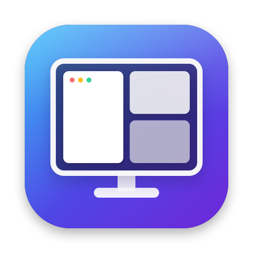

<p align="center"></p>

# WindowFrames

A small macOS menu bar app that snaps the front window into halves, quarters
and thirds with keyboard shortcuts. Free and open source (MIT).

## Using it

WindowFrames lives in the menu bar (the grid icon) and has no Dock icon.
Click the icon for:

- **Show WindowFrames**: opens the WindowFrames window, with a sidebar:
  - **Layouts**: click a tile to arrange the front window of the app you
    were just using.
  - **Shortcuts**: change, remove, reset or copy shortcuts from Magnet. The
    badge counts shortcuts that need attention.
  - **General**: Accessibility status and **Open at login**.
  - **About**: version, **Check for Updates** and the GitHub page.
- Every layout, with its shortcut.
- **Check for Updates…**, **About** and **Quit**.

Opening WindowFrames again from Finder, Spotlight or Launchpad while it is
running also brings up the window.

Needs macOS 13 Ventura or later, on Apple silicon or Intel.

## Commands and shortcuts

Every command is in the menu bar menu and in the window. The default
shortcuts are **Control + Option** (⌃⌥) plus a key:

| Command | Default |
|---|---|
| Left / right half | ⌃⌥← / ⌃⌥→ |
| Top / bottom half | ⌃⌥↑ / ⌃⌥↓ |
| Top left / top right quarter | ⌃⌥U / ⌃⌥I |
| Bottom left / bottom right quarter | ⌃⌥J / ⌃⌥K |
| Left / centre / right third | ⌃⌥D / ⌃⌥F / ⌃⌥G |
| Left / centre / right two thirds | ⌃⌥E / ⌃⌥R / ⌃⌥T |
| Next / previous display | ⌃⌥⌘→ / ⌃⌥⌘← |
| Maximise | ⌃⌥↩ |
| Centre | ⌃⌥C |
| Restore (size and place before WindowFrames moved it) | ⌃⌥⌫ |

Each command uses the screen the window is mostly on, and leaves room for the
menu bar and the Dock. On a portrait screen, thirds split the height.

### Change shortcuts

Open the window (**Show WindowFrames** or **Change Shortcuts…** in the menu),
then choose **Shortcuts** in the sidebar:

- Click a shortcut and press the new keys. Use at least one of ⌃ ⌥ ⌘, or a
  function key. Esc cancels.
- Click ⓧ to remove a shortcut.
- **Copy from Magnet** copies the shortcuts you set in Magnet, if Magnet is
  set up on this Mac. WindowFrames does this by itself on first launch.
- **Reset to Defaults** goes back to the table above.

A warning sign means another app already owns that shortcut (pick another),
or that it takes over a common shortcut such as ⌘Q or ⌘W in every app.
Quit Magnet before using the same shortcuts in WindowFrames.

## Install

### Option 1: download (no developer tools needed)

1. Open the [latest release](../../releases/latest) and download
   `WindowFrames-<version>.zip`.
2. Double-click the zip, then drag **WindowFrames.app** into **Applications**.
3. The app isn't notarised by Apple yet, so macOS blocks the first launch.
   Either run this once in Terminal:
   ```bash
   xattr -dr com.apple.quarantine /Applications/WindowFrames.app
   ```
   or open the app, then go to **System Settings → Privacy & Security** and
   click **Open Anyway**.
4. Open WindowFrames. A grid icon appears in the menu bar.
5. When asked, allow it under **System Settings → Privacy & Security →
   Accessibility**. WindowFrames needs this to move other apps' windows.

### Option 2: build from source

You need the Xcode Command Line Tools (`xcode-select --install`) or Xcode.

```bash
git clone https://github.com/reddy-sh/windowframes.git
cd windowframes
./scripts/install.sh
```

The script builds the app, copies it into `/Applications` (or
`~/Applications`) and opens it. Then allow Accessibility as in step 5.

## Update

**Check for Updates** (menu bar or window) asks GitHub for the latest
release and offers a Download button when a newer version exists.

- **Download:** quit WindowFrames, replace the app in Applications with the
  new one, and allow Accessibility again if shortcuts stop working.
- **Source:** `git pull && ./scripts/install.sh`.

Each new build has a new signature, so macOS treats it as a new app. The
install script clears the old Accessibility entry so the prompt comes back.
If you replaced the app by hand and shortcuts do nothing, remove WindowFrames
from the Accessibility list with the − button and add it again.

## Start at login

Turn on **Open at login** in the WindowFrames window. If macOS asks, allow it
under **System Settings → General → Login Items**. This works best with the
app installed in Applications.

## Uninstall

```bash
./scripts/uninstall.sh
```

Or quit it from the menu, delete it from Applications, and remove it from the
Accessibility list.

## Privacy

WindowFrames collects nothing. It reads and sets the position and size of
the focused window, and nothing else. **Copy from Magnet** reads only
Magnet's command list from its settings file. Its only network request is to
`api.github.com` for the latest release, and only when you click **Check for
Updates**.

## Build commands

| Command | Result |
|---|---|
| `./scripts/build-app.sh` | `build/WindowFrames.app` for this Mac |
| `ARCHS=universal ./scripts/build-app.sh` | Apple silicon + Intel app (needs Xcode) |
| `./scripts/package.sh` | `build/WindowFrames-<version>.zip` plus a SHA-256 file |
| `swift run` | Run without an app bundle (Accessibility is then granted to your terminal) |
| `./scripts/make-icon.sh` | Redraw `Resources/AppIcon.icns` and `docs/icon.png` |
| `WF_SNAPSHOT_DIR=/tmp/shots build/WindowFrames.app/Contents/MacOS/WindowFrames` | Render every page of the window to PNG, light and dark, then quit |

## Versions and releases

WindowFrames follows [Semantic Versioning](https://semver.org/spec/v2.0.0.html)
(`MAJOR.MINOR.PATCH`) and keeps its history in [CHANGELOG.md](CHANGELOG.md),
in the [Keep a Changelog](https://keepachangelog.com/en/1.1.0/) format.

| Where | Value |
|---|---|
| `VERSION` file | The version, e.g. `0.4.0`. The single source of truth |
| App (`CFBundleShortVersionString`) | Same as `VERSION` |
| App build (`CFBundleVersion`) | Number of commits, so it always goes up |
| Git tag | `v` + version, e.g. `v0.4.0` (annotated) |
| GitHub release | `WindowFrames v0.4.0`, notes from that version's changelog section |

Before 1.0.0, a new feature bumps MINOR and a fix bumps PATCH.

To release:

1. Move the `[Unreleased]` notes in `CHANGELOG.md` under a new
   `## [X.Y.Z] - YYYY-MM-DD` heading, and update the compare links at the bottom.
2. Set `VERSION` to `X.Y.Z`.
3. Commit, then tag and push:
   ```bash
   ./scripts/check-version.sh vX.Y.Z
   git tag -a vX.Y.Z -m "WindowFrames X.Y.Z"
   git push origin main vX.Y.Z
   ```

The tag runs `.github/workflows/build.yml`. It checks that the tag matches
`VERSION` and has a changelog section, builds a universal app on GitHub's
macOS runner, and publishes the zip with notes from `scripts/release-notes.sh`.

Release builds are signed ad hoc. To remove the Gatekeeper step for users,
sign with a Developer ID (`SIGN_IDENTITY="Developer ID Application: …"`) and
notarise with `xcrun notarytool`. That needs a paid Apple Developer account.

## Licence

MIT. WindowFrames is an independent project, written from Apple's public
APIs. It isn't affiliated with any other window manager.
